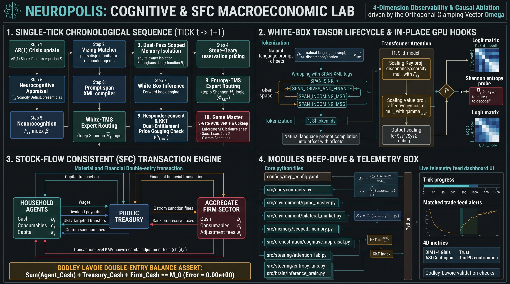

# Neuropolis: Mechanistic Cognitive Steering & Stock-Flow Consistent HANK Laboratory

`neuropolis` is a computational behavioral economics and mechanistic interpretability research platform. It investigates how macroeconomic shocks, liquidity constraints, and institutional rules alter human decision-making, bilateral bargaining, trust networks, and epistemic routing. Rather than relying on unconstrained prompt engineering, `neuropolis` couples inference-time White-Box PyTorch interventions on frozen open-weight language models directly to a 100% deterministic, Stock-Flow Consistent (SFC) macroeconomic and legal environment.

Standard Large Language Model (LLM) multi-agent frameworks inject economic and psychological variables solely as prompt text, which RLHF-aligned models frequently override in favor of sycophantic cooperation and hyper-rationality. `neuropolis` resolves this by keeping base LLM weights strictly frozen ($\theta_{\text{LLM}}$ fixed) and routing endogenous socio-economic states directly into the model's internal attention projections, Value subspaces, residual streams, and output logit entropy during the forward pass, while enforcing hard accounting and institutional laws via an atomic double-entry SQLite Game Master.

<p align="center">
  
</p>
---

## 1. Scientific & Architectural Foundations

The platform integrates two coupled computational planes controlled by an Orthogonal Clamping Vector $\mathbf{\Omega} = (\Omega_{\text{D1}}, \Omega_{\text{D2}}, \Omega_{\text{D3}}, \Omega_{\text{D4}}) \in \{0, 1\}^4$ that enables independent causal ablation across four foundational dimensions:

### A. White-Box Mechanistic Cognitive Steering Plane
Base language model weights ($\theta_{\text{LLM}}$) remain strictly frozen (`requires_grad = False`). Human cognitive bounds are induced at inference time during the forward pass via the **Unified Cognitive Attention Master Equation (v2.0)** and the **Semantic-Offset Entropy-Triggered Transactive Memory System (TMS)**:

- **State-Coupled Attention Bias ($B_{\text{env}}(E_t)$) & Hebbian Rumination ($H_t$):** Endogenous financial scarcity ($F_{i,t}$) and relational trust ($\tau_{ij,t}$) modulate key-projection salience across XML-compiled semantic token spans (`SPAN_DRIVES_AND_FINANCE`, `SPAN_PEER_MEMORY`, `SPAN_APPRAISAL_AND_TOM`).
- **Dual-Space Orthonormal Value Projection ($\tilde{V}_{\text{proj}}$):** Separates conscious selective attention in $QK$-space from unconscious cynical and threat-colored perceptual distortion in Value ($V$) space across middle transformer layers.
- **Cognitive Dissonance Attention-Sink Routing ($\mathbf{s}_{\text{sink}}(D_t)$):** Routes excess Softmax probability mass away from identity-contradicting messages directly into the `<bos>` attention sink ($s = 0$) without degrading syntactic or JSON schema fluency.
- **Yerkes-Dodson / LC-NE Thermodynamic Scaling ($\beta_{\text{LC}}$) & Dual-Process Head Gating ($g_h(L_t)$):** Modulates attention entropy as an inverted-U function of physiological arousal and cognitive fatigue while competitively gating System-1 induction heads against System-2 deliberative heads under scarcity load.
- **Semantic-Offset Entropy-TMS Router:** Evaluates normalized top-$p$ Shannon entropy $\bar{H}_i(c)$ over semantic content logits; when uncertainty exceeds $\tau_{\text{TMS}}$, halts generation to route `ASK_EXPERT` queries across a Bayesian Beta-Bernoulli social competence directory.

### B. Four-Dimensional Socio-Economic & Institutional Physics Plane
All material balances, inventories, taxes, and sanctions are governed by a deterministic `GameMaster` (`AccountingAndLawEngine`) enforcing double-entry ACID transactions and Godley-Lavoie money conservation ($\epsilon_{\text{SFC}} < 10^{-9}$):

- **Dimension 1 ($\Omega_{\text{D1}}$) — Two-Asset HANK & Crisis Engine:** Models liquid `CASH` ($b_{i,t}$ with credit limit $\underline{b}_{i,t}$ and borrowing wedge $\kappa_t$), non-durable `CONSUMABLE_NECESSITY` ($c_{i,t}$ with Stone-Geary subsistence threshold $\bar{c}_{\min}$ and endogenous production $Q_{i,t}$), and durable `PRODUCTIVE_CAPITAL_ASSET` ($a_{i,t}$ with periodic yield $r_{K,t}$, Kaplan-Moll-Violante convex adjustment cost $\chi(d_{i,t}, a_{i,t})$, and present-biased distress fire-sale liquidation). Supports four parameterized $\text{AR}(1)$ crisis regimes: `STAGFLATION_SUBSISTENCE_SHOCK`, `ASYMMETRIC_UNEMPLOYMENT_SHOCK`, `ASSET_VALUATION_CRASH`, and `LIQUIDITY_CREDIT_CRUNCH`.
- **Dimension 2 ($\Omega_{\text{D2}}$) — Three-Tier Social Trust & Parochial Markets:** Couples Slovic negativity-biased Relational Trust ($\tau_{ij,t}$), five-driver Generalized Social Trust ($\bar{T}_{\text{soc},t}$ driven by Wealth Gini, Between-Group Theil inequality, public goods compliance, and scarcity), and Institutional Trust ($T_{\text{inst},t}$) with Fehr-Schmidt (1999) inequity aversion $(\alpha_i, \beta_i)$ and Kahneman-Knetsch-Thaler (1986) dual-entitlement price-gouging indices ($\Phi_{ij,t}^{\text{KKT}}$).
- **Dimension 3 ($\Omega_{\text{D3}}$) — Dual-Pathway Contagion & Opinion Dynamics:** Combines Barsade (2002) 93% non-verbal (middle-layer residual activation leakage) / 7% verbal affective contagion with Friedkin-Johnsen, adaptive Hegselmann-Krause bounded confidence ($\epsilon_{ij}(t)$), Sharot (2011) optimism asymmetry ($\psi = 0.6875$), and Centola-Macy complex contagion cascades.
- **Dimension 4 ($\Omega_{\text{D4}}$) — Deterministic Fiscal, Commons & Ostrom Legal State:** Executes sales taxation, Saez (2001) three-bracket progressive income and wealth taxation, Universal Basic Income vs. targeted scarcity transfers, Fehr-Gächter (2000) public goods provisioning, and Ostrom (1990) graduated sanctions.

---

## 2. Execution & Verification Protocol

### Pre-Flight Mathematical & Counterfactual Verification (`< 5 Seconds`)
Execute the automated verification suite to validate Stock-Flow Consistency ($\epsilon_{\text{SFC}} < 10^{-9}$), KMV convex adjustment costs, scarcity fire-sale triggers, Slovic trust asymmetry, $\mathbf{\Omega} = (0,0,0,0)$ neoclassical clamping, epistemic memory isolation, Semantic-Offset Entropy-TMS routing, and White-Box steering sensitivity:

```bash
rm -f data/*.sqlite data/*.jsonl
python -m tests.preflight.verify_environment_and_telemetry
```

### Running White-Box Steered Simulations & Causal Ablations
Execute the full White-Box simulation (`Qwen/Qwen2.5-1.5B-Instruct`) with live ANSI telemetry, real-time event streaming to `data/live_stream.jsonl`, and end-of-run empirical scorecard evaluation:

```bash
# Full 4-Dimensional White-Box Simulation under Stagflation Subsistence Shock
python run_mvp.py --ticks 8 --omega 1,1,1,1 --crisis STAGFLATION_SUBSISTENCE_SHOCK

# Neoclassical Baseline (All Behavioral & Institutional Dimensions Clamped OFF)
python run_mvp.py --ticks 8 --omega 0,0,0,0 --crisis NONE

# Orthogonal Ablation: Clamping Trust (D2) and Fiscal/Legal State (D4) to Baseline
python run_mvp.py --ticks 8 --omega 1,0,1,0 --crisis ASSET_VALUATION_CRASH

# Alternative Macroeconomic Crisis Regimes
python run_mvp.py --ticks 8 --omega 1,1,1,1 --crisis ASYMMETRIC_UNEMPLOYMENT_SHOCK
python run_mvp.py --ticks 8 --omega 1,1,1,1 --crisis LIQUIDITY_CREDIT_CRUNCH

# Fast Deterministic Behavioral-Economics Verification Mode (No GPU Required)
python run_mvp.py --mock-brain --ticks 8 --omega 1,1,1,1 --crisis STAGFLATION_SUBSISTENCE_SHOCK
```

---

## 3. Overarching Scientific Vision & Empirical Benchmark Objectives

`neuropolis` is designed to bridge mechanistic interpretability and empirical macro-behavioral economics. Every simulation run is quantitatively benchmarked at termination via **1-Wasserstein Distance ($W_1$)** and **Jensen-Shannon Divergence ($D_{\text{JS}}$)** against five canonical empirical targets:

1. **Kaplan, Moll, & Violante (2018, *AER*):** Poor vs. Wealthy Hand-to-Mouth ($\text{HtM}$) shares, illiquid asset fire-sales, and realized Marginal Propensity to Consume ($\text{MPC}$) under two-asset illiquidity.
2. **Mani et al. (2013, *Science*):** Scarcity-induced cognitive bandwidth tax (standardized effect size Cohen's $d \in [0.88, 0.94]$ on System-2 executive control).
3. **Alesina & La Ferrara (2002, *JPubE*) & Fehr & Schmidt (1999, *QJE*):** Generalized trust erosion under rising wealth inequality ($\beta_{\text{Gini}} \approx 0.70$) and bilateral unfairness rejection rates.
4. **Barsade (2002, *ASQ*) & Hegselmann & Krause (2002):** Group affective synchronization ($\text{ASI}_t$) and bounded-confidence ideological bimodality ($\text{BC}_t$).
5. **Fehr & Gächter (2000, *AER*) & Ostrom (1990) / Saez (2001, *RES*):** Public goods provision sustainment under graduated peer/institutional sanctioning and optimal progressive redistribution.